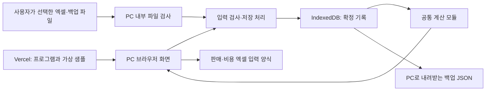

# 카페 운영 기록 웹 프로그램 기술 요구사항 문서(TRD)

- 작성일·공식 자료 확인일: 2026-10-12
- 기준: [PRD](01_PRD.md), [FRD](02_FRD.md), [시안 디자인 지침](../design/warm_operational_erp/DESIGN.md)과 `design/_1`~`design/_4`의 HTML·이미지.
- 상태: 추천 기술안으로 문서 작성 완료. 코드 작성, GitHub 저장소 생성·업로드, Vercel 배포, 성능·보안 검사는 아직 실행하지 않았다.
- 사용자 지시: TRD는 추천대로 완성한다. 기술 선택을 위한 추가 질문 없이 결정하되 PRD·FRD의 기능·사용 순서·계산 기준은 바꾸지 않는다.
- TRD는 기술 요구사항 문서다. 화면, 계산, 저장, 파일과 배포를 어떤 구성으로 만들지 설명한다.

## 1. 설계 결론과 사용 범위

**React·TypeScript·Vite로 만든 웹 화면을 Vercel에서 제공하고, 매장 기록은 운영자 PC의 IndexedDB에 보관한다.** IndexedDB는 브라우저 안에서 큰 기록을 지속 보관하는 저장소다. GitHub는 프로그램 소스와 설계 문서를 보관하며 매장 기록의 백업 장소로 사용하지 않는다.

한 매장·운영자 한 명·같은 PC·같은 브라우저 프로필에서 사용한다. 서버 데이터베이스, 기록 전송용 API, 로그인, 여러 기기 동기화는 도입하지 않는다. 새 업무 기능을 늘리지 않고 FRD F01~F17을 구현한다. 2차 X01~X06과 보류 기능은 1차 코드의 실제 메뉴·계산에 넣지 않는다.

사용 순서는 제공 자료 시작 → 판매/비용 입력 또는 판매/비용 엑셀 가져오기 → 메뉴 수익성 → 기간 손익·재료 잔량 → 재고 기록 → 저장·백업·복원을 그대로 따른다. 순서는 사용자가 기능을 이해하는 기본 흐름이며 화면 이동을 강제로 잠그는 단계식 절차를 추가하지 않는다.

### 1.1 Vercel과 ‘같은 PC 사용’의 관계

Vercel 주소는 프로그램을 받는 장소다. 주소를 방문하면 HTML·CSS·JavaScript와 공개 가능한 가상 샘플만 내려받는다. 입력한 매출·비용·재고와 선택한 엑셀·백업 파일은 브라우저에서 처리하며 Vercel·GitHub로 보내지 않는다.

다른 사람이 같은 주소를 열어도 운영자의 PC 기록을 볼 수 없고, 자기 브라우저의 별도 자료를 보게 된다. URL 자체의 접근을 특정 PC로 제한하는 장치는 이번 범위에 없다. ‘같은 PC 사용’은 운영 방식이며 IP 제한·사용자 인증을 보장한다는 뜻이 아니다.

처음 열기와 새 프로그램 파일 받기에는 인터넷이 필요하다. 열린 화면의 기록 처리는 로컬에서 가능하다. 다만 아직 내려받지 않은 엑셀 처리 모듈 등은 인터넷이 끊기면 열리지 않을 수 있으므로 원인과 재시도를 안내한다. 오프라인 재실행을 보장하는 설치형 PWA·Service Worker는 1차에 추가하지 않는다. 시안의 ‘오프라인 우선’은 기록 처리가 로컬이라는 의미로 설명하고 완전 오프라인 실행을 약속하지 않는다.

### 1.2 주소와 브라우저 프로필

IndexedDB는 웹사이트의 출처, 즉 프로토콜·호스트·포트별로 나뉜다. 개발 주소, 미리보기 주소, 운영 주소는 같은 PC에서도 서로 다른 기록이다. [IndexedDB 공식 설명](https://developer.mozilla.org/en-US/docs/Web/API/IndexedDB_API/Using_IndexedDB).

- 운영은 고정된 HTTPS 운영 주소 하나를 즐겨찾기에 등록한다. 배포마다 바뀌는 미리보기 주소로 실사용하지 않는다.
- 같은 운영 주소의 프로그램을 업데이트하면 저장 기록을 이어서 읽는다. 배포 과정에서 브라우저 자료를 초기화하지 않는다.
- 도메인·브라우저·프로필을 바꿀 때는 기존 환경에서 백업하고 새 환경에서 복원한다. 자동 기기 공유를 만들지 않는다.
- 브라우저 사이트 데이터 삭제·시크릿 모드 종료·PC 손상에는 별도 백업이 필요하다. 저장소 지속 보관을 요청할 수 있지만 허용 여부는 브라우저가 결정한다. [브라우저 저장 용량·삭제 정책](https://developer.mozilla.org/en-US/docs/Web/API/Storage_API/Storage_quotas_and_eviction_criteria).

## 2. 추천 기술 구성

| 영역 | 채택 기술 | 쉬운 설명·선정 이유 |
| --- | --- | --- |
| 화면 | React + TypeScript | 화면을 기능별로 나누고 날짜·금액·기록 종류를 혼동하는 개발 오류를 줄인다. |
| 개발·배포 파일 생성 | Vite | 개발 화면 실행과 Vercel에 올릴 정적 파일 생성을 맡는다. 서버 실행 기능이 필요 없는 현재 범위에 적합하다. |
| 디자인 | Tailwind CSS, 프로젝트 내 CSS·SVG | 기존 시안의 색·표·입력창을 구성한다. CDN 스크립트 없이 빌드에 포함한다. |
| 브라우저 저장 | IndexedDB + Dexie | 저장 성공/실패와 여러 탭의 충돌을 한 저장 단위로 다룬다. Dexie는 IndexedDB 사용을 단순하게 하는 도구다. |
| 데이터 검사 | Zod | 화면 입력·샘플·엑셀·백업 자료가 정해진 형식인지 같은 규칙으로 검사한다. |
| 정밀 계산 | decimal.js | 원화·소수 원가·재료 수량 계산의 일반적인 소수 오차를 줄인다. |
| 엑셀 | ExcelJS의 브라우저용 문서 처리 | `.xlsx` 양식을 만들고 읽는다. 매장 기록을 외부 변환 서버에 보내지 않는다. |
| 오래 걸리는 파일 처리 | Web Worker | 엑셀 검사·백업 검사·대량 집계를 화면과 분리해 화면 멈춤을 줄인다. |
| 계산 검사 | Vitest | FRD의 금액·재고 예시와 예외를 자동 확인한다. |
| 실제 사용 흐름 검사 | Playwright | 브라우저에서 입력·저장·재실행·파일 가져오기·복원을 확인한다. |
| 코드 보관·배포 | GitHub 비공개 저장소 + Vercel Git 연동 | 검토한 코드 변경을 보관하고 미리보기/운영 배포를 구분한다. |

React의 Vite 기반 구성은 [React 공식 안내](https://react.dev/learn/build-a-react-app-from-scratch), Tailwind 연결은 [공식 Vite 설치 안내](https://tailwindcss.com/docs/installation/using-vite)를 따른다. Vercel은 [Vite 배포](https://vercel.com/docs/frameworks/frontend/vite)를 지원한다.

Node.js는 개발·검사·빌드에만 사용한다. **22.x, 최소 22.12 이상**으로 개발·GitHub 검사·Vercel 설정을 맞춘다. 브라우저에서 실행되는 업무 프로그램에는 Node 서버가 없다. 이 범위는 [Vite 요구 환경](https://vite.dev/guide/)과 [Vercel 지원 Node 버전](https://vercel.com/docs/functions/runtimes/node-js/node-js-versions)을 함께 고려한 선택이다.

개발 착수 때 호환되는 안정 버전 조합을 설치하고 `package-lock.json`에 정확한 버전을 고정한다. 설치는 `npm ci`로 재현한다. 문서 작성만으로 설치·호환성 검사가 끝났다고 보지 않는다. 보안 수정이 필요하면 잠금 파일을 갱신하고 관련 검사를 다시 실행한다. 실행 중 외부 CDN에서 최신 라이브러리를 가져오지 않는다.

## 3. 프로그램 내부 구조



화면에 계산식을 각각 작성하지 않는다. 입력창 미리보기, 메뉴 수익성, 기간 손익, 재고, 가져오기 후 계산이 같은 공통 계산 모듈을 사용한다. 화면은 계산 결과와 상태를 받아 표시한다.

| 계층 | 책임 | 금지 사항 |
| --- | --- | --- |
| 화면 | 조회 조건·입력값·오류 위치·저장 상태 표시 | 화면에서 직접 저장소를 바꾸거나 별도 원가식을 구현하지 않음 |
| 업무 처리 | 입력 검사, 수정 대상 확인, 중복 검사, 저장 요청 | 실패한 변경을 성공으로 알리지 않음 |
| 계산 | FRD C01~C07, 기간·마감·실사 처리 | 파일 접근·네트워크·현재 화면 상태에 의존하지 않음 |
| 저장 | 한 번의 확정 변경을 통째로 보관 | 합계만 저장해 원본 근거를 잃지 않음 |
| 파일 | 양식 생성, 엑셀/백업 해석, 검사 결과 | 가져오기 검사 중 기록을 변경하지 않음 |

### 3.1 권장 파일 구성

다음은 앞으로 만들 구조이며 현재 코드가 존재한다는 뜻이 아니다.

```text
src/
  app/                  화면 틀·다섯 메뉴·공통 조회 조건
  features/
    dashboard/          일·월 손익
    profitability/      메뉴 수익성·읽기 전용 레시피
    records/            판매·비용 목록과 입력창
    inventory/          잔량·입고·폐기·실사
    data-management/    양식·가져오기·백업·복원
  domain/
    schemas.ts          기록·입력·백업 형식 검사
    sales.ts            순매출·원가·공헌이익
    profit.ts           기간 손익
    inventory.ts        재료 사용량·실사·잔량
    dates.ts            한국 날짜·마감·조회 범위
    decimal.ts          정밀 숫자·표시 반올림
  storage/              IndexedDB·변경번호·통째 저장
  files/                ExcelJS·백업 형식·중복 검사
  workers/              파일 검사·대량 계산
  styles/               시안 공통 디자인
public/sample/          공개 가능한 가상 샘플 한 종류만
tests/                  계산·저장·브라우저 검사
docs/                   PRD·FRD·TRD
```

전역 상태 관리용 대형 도구는 도입하지 않는다. React의 Context와 reducer로 저장된 자료 버전, 조회 조건, 입력 중 상태를 구별한다. 다섯 화면 이동은 URL 해시(`#dashboard` 등)를 사용해 정적 배포의 새로고침 경로 오류를 피한다. 검색·입력·파일명·금액을 URL에 넣지 않는다.

## 4. 시안 구현 원칙

- [대시보드](../design/_1/code.html), [메뉴 수익성](../design/_2/code.html), [판매·비용](../design/_3/code.html), [재고](../design/_4/code.html)의 공통 틀·표·입력창을 React 구성요소로 옮긴다. 시연 JavaScript를 업무 로직으로 그대로 사용하지 않는다.
- 특히 시안의 `parseFloat(값) || 0`은 공란을 0으로 바꾸므로 사용하지 않는다. 실사 성공 알림만 띄우는 시연 코드도 실제 저장 완료 처리로 교체한다.
- FRD 7장의 버튼 처리 목록을 구현 기준으로 삼는다. 시안의 리포트 내보내기·발주 등록·감사 로그·임계값 편집·시뮬레이션은 활성 기능으로 넣지 않는다.
- 실제 품목·가격·레시피는 저장 기록에서 표시한다. 시안의 HOT/ICED 품목·R2 레시피·고정 수수료·목표·직원 수를 자료로 생성하지 않는다.
- 비용 입력, 판매 저장/취소, 양식 가져오기, 백업·복원 화면은 FRD 범위에서 기존 공통 구성요소로 보완한다. 판매 화면 `screen.png`는 손상되어 HTML을 기준으로 구현하고 브라우저에서 다시 확인한다.
- PC 화면을 우선하며 1,280px·1,440px 너비에서 검토한다. 긴 표는 가로/세로 스크롤로 읽고 입력창의 저장·취소가 화면 밖으로 사라지지 않게 한다. 좁은 화면의 정리는 새 모바일 업무 기능으로 확장하지 않는다.
- 색상만으로 손익·오류·저장 상태를 구별하지 않고 문구·부호·단위를 함께 표시한다. 입력마다 연결된 이름표, 키보드 포커스, 오류 설명을 제공한다. 창을 열고 닫을 때 포커스가 원래 조작으로 돌아가게 한다.
- 원격 글꼴·이미지·Google 아이콘 주소 의존을 제거한다. 시스템 글꼴과 프로젝트 안의 SVG를 기본 사용한다. 사용할 외부 자산이 있으면 사용권을 확인한 파일만 포함한다.

## 5. 데이터 구조와 저장

### 5.1 원본과 프로그램 기록

원본 JSON 약 3.46MB, 엑셀 약 0.49MB, 기록 약 1.2만 행을 기준 규모로 삼는다. 초기 자료는 **JSON 한 형식**만 프로그램용 샘플로 사용한다. 원본 엑셀·JSON의 두 번 가져오기와 JSON의 빈 `settings`를 합의된 정책으로 오해하는 일을 막는다.

| 기록 묶음 | 보관할 핵심 내용 |
| --- | --- |
| 공급사·재료·메뉴 | 원본 ID·이름·단위·구매용량·납기·안전일수·분류·버전 |
| 레시피·가격이력 | 메뉴/재료 연결, 버전, 사용량·단위·채널, 가격 적용일·구매금액·용량 |
| 달력·초기재고 | 영업/마감·날씨·메모, 최초 기준일·수량 |
| 판매 | 원본/새 ID, 날짜·메뉴·채널·수량·단가·할인·순매출·수수료·버전·당시 개당 원가 |
| 재고 이벤트 | ID·일자·재료·종류·증감·단위·사유·입고 단가·공급사·실측값·당시 차이 |
| 비용·월계획 | ID·귀속일·항목·금액·기록 성격, 월계획은 실적 비용과 분리 |
| 자료정보·내부 메타정보 | 출처·기준일·형식 버전·계산 버전·저장 변경번호·마지막 저장 성공 시각·마감 후 수정 확인 필요 날짜 |

원본 판매·재고·비용 ID는 유지하고 새 기록은 `crypto.randomUUID()` 기반 접두사 ID로 생성한다. 동일한 원본 ID를 새 ID로 바꿔 재가져오기 중복 검사를 피하지 않는다. 판매의 날짜·메뉴·채널 조합도 별도로 유일성을 검사한다.

금액·원가·재료 수량은 정밀한 십진수 **문자열**로 저장하고 계산할 때 숫자 도구로 변환한다. 화면의 ‘1,000원’ 같은 표시 문자열을 자료로 저장하지 않는다. 판매량은 검증된 양의 정수, 날짜는 `YYYY-MM-DD`, 월은 `YYYY-MM`, 시각 메타정보는 UTC ISO 형식을 사용한다. 업무 날짜 판단·표시는 `Asia/Seoul`로 고정한다.

### 5.2 한 상태를 통째로 저장하는 구조

1차는 여러 테이블에 기록을 나눠 쓰기보다 IndexedDB의 `appState` 저장소에 `current` 한 건으로 전체 확정 자료를 보관한다. 이는 작은 단일 매장 자료에서 복원·중복·동시 변경을 단순하고 안전하게 만들기 위한 선택이다.

`current`에는 `schemaVersion`, `calculationVersion`, `revision`, `savedAt`, `initialized`, `dataset`을 둔다. `revision`은 저장할 때마다 증가하는 변경번호다. 입력창과 파일 검사 결과는 시작한 변경번호를 기억한다.

- 화면 미리보기와 임시 파일 검사 자료는 메모리에만 둔다. 입력 중 자동 저장을 만들지 않는다.
- 원본 기록을 정답으로 보관하고 일별/메뉴별 합계·재고는 계산 결과로 메모리에서 만든다. 저장된 합계 때문에 원본과 결과가 달라지는 이중 관리 구조를 피한다.
- `initialized`와 상태 존재 여부로 처음 실행을 구분한다. 유효한 빈 백업을 복원한 상태를 처음 실행으로 오해해 샘플을 다시 채우지 않는다.
- 저장된 자료 읽기 실패는 상태 오류다. 실패를 ‘기록 없음’으로 판단해 샘플로 덮어쓰지 않는다.
- 이 구조는 매번 전체 자료를 복사·저장하므로 대규모 자료에 최적화된 구조는 아니다. 성능 목표 미달 시 같은 기능과 계산을 유지하며 내부 저장 방식만 재검토한다. 오래된 기록을 자동 삭제해 성능을 맞추지 않는다.

### 5.3 확정 저장 순서와 충돌

1. 화면/가져오기에서 현재 확정 상태와 변경번호를 읽는다.
2. 트랜잭션 밖에서 입력·연결·중복·계산 가능성을 검사하고 다음 상태 후보를 만든다. 트랜잭션은 여러 저장 작업을 성공 또는 실패 한 묶음으로 처리하는 단위다.
3. Dexie 읽기/쓰기 트랜잭션에서 `current`를 다시 읽는다. 후보가 검사한 변경번호와 다르면 아무것도 쓰지 않고 재조회를 안내한다.
4. 변경번호가 같으면 후보 자료와 새 변경번호·저장시각을 함께 기록한다. 다중 탭도 동일 저장소의 트랜잭션과 변경번호로 경합을 막는다.
5. 트랜잭션이 완료된 뒤 화면의 확정 상태를 교체하고 모든 관련 집계를 해당 변경번호로 다시 표시한다. 이전 결과를 새 기록의 결과처럼 보여 주지 않는다.

파일 읽기, Worker 응답 대기, 네트워크 요청은 저장 트랜잭션 안에서 하지 않는다. 기다리는 중 IndexedDB가 트랜잭션을 자동 종료할 수 있기 때문이다. [Dexie 트랜잭션 안내](https://dexie.org/docs/Dexie/Dexie.transaction()).

BroadcastChannel로 다른 탭에 변경 사실만 통지하고 개인정보는 메시지에 싣지 않는다. 지원하지 않아도 저장 직전 변경번호 검사는 작동해야 한다. 오래된 탭의 입력은 자동 병합하지 않는다. 중복 저장 클릭은 처리 중 비활성화로 막는다.

브라우저의 저장 완료는 무정전 보관을 보장하지 않는다. 전원 차단·디스크 손상까지 이전 상태 보존을 약속하지 않고 별도 백업이 복구 수단임을 안내한다.

### 5.4 프로그램 업데이트와 자료 버전

첫 버전은 데이터 형식 `1`, 계산 규칙 `1`로 시작한다. 읽을 수 없는 미래 버전은 수정·복원하지 않고 해당 버전을 지원하는 프로그램이 필요함을 알린다. 마이그레이션은 기존 기록을 새 형식으로 옮기는 절차로, 구현 시 검증된 변환만 실행한다.

1차에 임의의 구버전 변환을 만들지 않는다. 형식 변경이 필요한 업데이트는 백업·복원 검사와 이전 버전 호환성 확인 후 배포한다. 코드 롤백과 자료 롤백을 혼동하지 않는다. 브라우저 자료가 새 형식이면 오래된 코드가 이를 덮어쓰지 못하게 한다.

## 6. 계산 구현 기준

**FRD C01~C07이 업무 계산의 기준이다.** 이 장은 동일한 계산을 코드에서 안전하게 수행하는 방법이며 수수료율·배분·재고 정책을 새로 정하지 않는다.

| FRD | 구현 모듈·방식 | 유지할 기준 |
| --- | --- | --- |
| C01 | `sales.ts` 순매출 검사·산출 | 수량×실제 단가−행 전체 할인. 수수료는 행 전체 입력금액. 2.5% 고정 없음 |
| C02 | 재료별 적용일 정렬 가격 조회, 메뉴/버전별 레시피 조회 | 판매일 이하 최근 가격. 개당 식재료/포장 원가 구별, 포장 채널 적용, 원본 당시 원가 보존 |
| C03 | 메뉴/채널별 정확한 합계 후 비율 산출 | 공통비 배분 없음. 행별 이익률 단순 평균 금지. 매출 0은 비율 계산 불가 |
| C04 | 판매와 일별 비용을 같은 귀속 범위로 집계 | 월계획·입고 대금 중복 차감 없음. 폐기/실사 평가액 추가 계산 없음 |
| C05 | 레시피별 재료 사용량과 이벤트 재생 | 초기재고 포함. 포장재 사용량 포함. 음수 잔량 유지. 단위 다른 수량 합산 금지 |
| C06 | 재료별 실사일 순서와 마감 실측 기준 | 실측 후 다음 날부터 변화 반영. 원본 조정량 이중 반영 금지. 과거 수정이 확인된 실측량을 바꾸지 않음 |
| C07 | 정밀 계산과 최종 표시 함수를 분리 | 원본 소수 보존. 중간 원 단위 반올림 없음. 원화 표시 정수 원, 비율 소수 첫째 자리 |

금액·수량 계산에 JavaScript 일반 소수 연산을 직접 사용하지 않는다. decimal.js에 유효숫자 40자리와 `ROUND_HALF_UP`을 설정하고 표시에서만 정해진 자릿수로 반올림한다. 이 반올림은 음수도 절댓값 기준으로 동일하게 처리한다. 무한소수 나눗셈의 수치 표현 한계는 있지만 중간 결과를 정수 원이나 소수 셋째 자리로 잘라 업무 결과를 바꾸지 않는다. [decimal.js 정밀도·반올림 안내](https://mikemcl.github.io/decimal.js/).

입력 가능한 금액은 안전한 정수 범위 안인지 검사하고, 예상치 못한 지나치게 큰 숫자는 계산 범위 오류로 알린다. 원본 숫자를 문자열로 바꿀 때 값을 변경하거나 표시용 반올림을 거치지 않는다. 날짜는 시간대가 섞인 `Date` 비교 대신 검증한 날짜 문자열·날짜 구성값으로 비교한다.

계산 함수는 `정상 값`, `자료 없음`, `계산 불가와 이유`, `부분 자료와 경고`를 구별해 반환한다. 오류를 0으로 바꾸거나 누락 행을 조용히 빼고 정상 총합으로 표시하지 않는다. 공헌이익·손익이 음수인 것은 계산 오류가 아니라 실제 표시할 결과다.

### 6.1 판매·재고 변경의 연결

- 판매 저장 전에 당시 원가와 레시피 버전을 확정해 저장 후보에 포함한다. 미리보기는 잔량을 바꾸지 않는다.
- 수량·단가·할인·수수료 수정은 FRD대로 보관된 개당 원가를 유지한다. 날짜·메뉴·채널 변경은 새 조건의 원가를 검사하고 변경 전후를 확인한다.
- 판매 사용량을 별도 차감 이벤트로 또 저장하지 않는다. 확정 판매와 레시피에서 다시 계산해 수정·삭제 시 이중 차감을 막는다.
- 실측값이 있는 원본 이벤트는 해당 날짜 마감 기준으로 삼고 보관된 조정량을 다시 합하지 않는다. 실측값 없는 조정은 원본 부호로 반영한다.
- 마감일에 기록을 변경하면 `reviewRequiredDates`에 표시한다. 달력의 원래 마감 값을 자동 승격·재마감하지 않는다. 별도 마감 기능은 추가하지 않는다.

## 7. 엑셀 양식과 가져오기

### 7.1 양식 만들기

ExcelJS는 브라우저에서 문서 전체를 메모리로 처리한다. 브라우저 스트리밍 처리 지원을 전제로 설계하지 않는다. [ExcelJS 공식 문서](https://github.com/exceljs/exceljs#browser).

- `판매기록_입력양식.xlsx`: 안내와 판매기록 시트. ID, 날짜, 메뉴ID, 채널, 수량, 실제 단가, 전체 할인, 전체 수수료.
- `비용기록_입력양식.xlsx`: 안내와 비용기록 시트. ID, 귀속일, 비용항목, 금액.
- 시트 이름·열 이름·형식 버전은 생성기와 읽기 도구가 같은 상수에서 사용한다. 날짜 예시·원/개 단위·새 기록 ID 공란·수식 금지와 허용 코드 목록을 안내한다.
- 값은 숫자/날짜/문자에 맞춰 저장한다. 프로그램 계산 결과를 입력 양식에 사용자가 작성하는 필드로 추가하지 않는다.
- 생성한 `ArrayBuffer`를 Blob으로 내려받고 임시 URL을 해제한다. 다운로드 시작과 사용자 PC 저장 완료를 구별한다. 서버 업로드와 실적 리포트 내보내기는 없다.

### 7.2 읽기와 반영

1. 사용자가 파일과 판매/비용 대상을 선택한다. `.xlsx` 외 형식, 암호 파일·손상 파일은 지원하지 않는다.
2. Worker에서 파일 구조·시트·열·셀 값을 읽는다. 빈 행을 제외하고 데이터 행의 엑셀 행 번호를 유지한다.
3. 숫자형 날짜는 통합문서의 1900/1904 날짜 체계를 확인해 변환하고, 문자 날짜는 `YYYY-MM-DD`만 허용한다. ExcelJS의 날짜형을 처리할 때 현지 시간대 변환으로 하루를 밀지 않는다.
4. 수식 셀·공유 수식·수식 결과 캐시를 실제 입력값으로 인정하지 않는다. 외부 링크·매크로를 실행하거나 방문하지 않는다. ExcelJS는 수식 계산기로 사용하지 않는다.
5. 화면 입력과 같은 스키마·메뉴 연결·원가 근거·중복 검사를 적용하고 정상/중복 제외/오류 목록을 만든다.
6. 오류가 하나라도 있으면 전체 반영을 막는다. 오류 없는 검사 결과를 사용자가 확정할 때 검사를 시작한 변경번호를 다시 확인하고 새 행만 통째로 저장한다.
7. 성공 후 추가/중복 제외 건수와 연관 결과를 갱신한다. 입력 파일은 덮어쓰지 않고 오류 보고서 파일 등 새 산출물을 추가하지 않는다.

### 7.3 중복 검사

FRD F14의 규칙을 그대로 구현한다. ID 일치·내용 일치는 제외, ID 일치·내용 다름은 오류다. ID 없는 판매는 날짜·메뉴·채널 기준으로 내용이 같으면 제외하고 다르면 수정 안내를 한다. ID 없는 같은 날짜·항목·금액의 비용은 식별 불가 오류이며 자동 추가하지 않는다. 파일 내부 행끼리도 동일 규칙으로 비교한다.

날짜·숫자·빈칸 표현을 표준화한 뒤 비교하고 저장 내용의 의미를 바꾸는 자동 보정은 하지 않는다. 직접 비용 입력의 ‘중복 가능성 확인 후 추가’와 엑셀의 ‘식별 불가 중복 오류’는 FRD대로 서로 다르게 유지한다.

### 7.4 자원 소모 제한

초기 기술 한도로 엑셀 10MiB, 데이터 행 20,000개/파일, 읽은 셀 200,000개, 압축 해제 총량 64MiB를 둔다. 압축파일 목록과 실제 해제량을 제한해 작은 파일이 과도한 메모리를 쓰는 일을 막는다. 한도를 넘으면 저장 전 중단하고 파일 분리를 안내한다. 자료를 잘라서 몰래 일부만 반영하지 않는다.

파일 검사 30초 제한과 취소를 제공하고 Worker가 비정상 종료되면 전체 검사를 실패로 처리한다. 이 값은 제품 기록 보관 기간을 제한하는 정책이 아니라 과도한 파일로 화면이 멈추는 것을 막는 기술 기본값이다. 실제 검사에서 기준 규모에 부족하면 한도를 조정하고 근거를 기록한다.

## 8. 백업과 복원

### 8.1 백업 파일 규격

FRD대로 UTF-8 JSON 파일 하나를 사용한다. 파일명은 `프렙카페_백업_YYYYMMDD_HHMMSS.json`이며 이름의 날짜는 한국 시간, 파일 내부 생성시각은 UTC ISO로 기록한다.

| 필드 | 의미 |
| --- | --- |
| `format` | 프로그램 백업임을 구별하는 고정 식별자 |
| `backupVersion` | 백업 구조 버전 1 |
| `schemaVersion`, `calculationVersion` | 데이터 구조와 FRD 계산 규칙 버전 |
| `appVersion`, `exportedAt` | 만든 프로그램 버전과 파일 생성시각 |
| `recordBasis` | 원본 기준일, 자료 범위·마감 설명 |
| `dataset` | 공급사부터 자료정보까지 전체 기록·정밀 숫자·마감 후 확인 필요 상태 |

백업에 화면의 미확정 입력·불러온 임시 파일·비밀키를 포함하지 않는다. 표시용 합계를 복원의 근거로 쓰지 않는다. 마지막 성공 상태를 한 번 읽어 파일 전체가 같은 변경번호에서 생성되게 한다.

### 8.2 복원 처리

1. 선택 파일이 프로그램 백업인지 확인한다. 원본 가상 샘플 JSON은 백업과 구별해 안내한다.
2. Worker에서 JSON 구문, 버전, 필수 필드, ID 중복, 참조, 날짜·금액·단위·실측 관계를 검사한다. 빈 파일은 오류, 유효한 빈 데이터 묶음은 삭제될 기록 수를 명확히 알리고 확인한다.
3. 복원 후 자료로 계산 모듈을 시험 실행한다. 보존된 과거 순매출 불일치 등 계산 경고는 숨기지 않고 보여 준다. 구조상 불완전한 자료는 전체 복원을 막는다.
4. 현재 자료를 백업하도록 안내하고 전체 교체 확인을 받는다. 자동 백업 생성·자료 병합을 하지 않는다.
5. 저장 변경번호 재검사와 단일 트랜잭션으로 전체 교체한다. 로컬 변경번호는 복원 파일의 옛 번호로 되돌리지 않고 현재 번호에서 증가시켜 오래된 탭이 덮어쓰지 못하게 한다.
6. 완료 후 이전 입력창·임시 집계·검사 결과를 폐기하고 복원된 기록에서 다시 계산한다. 실패·취소는 기존 자료를 유지한다.

백업 파일은 최대 50MiB를 기술 기본값으로 검사하고 과도한 중첩 구조·알 수 없는 필드는 안전한 스키마 경계에서 거부한다. `eval`이나 임의 객체 병합을 사용하지 않는다. 미래 버전은 추측해서 읽지 않는다. 백업 파일 내용은 스크립트가 아닌 데이터다.

### 8.3 백업 보관의 한계

기본 JSON 백업은 암호화되지 않은 파일이다. 프로그램에 암호·암호키 관리 기능을 새로 추가하지 않는다. PC에 접근하거나 백업 파일을 받은 사람은 내용을 읽을 수 있으므로 운영자 전용 폴더·암호화된 외장 저장장치 등으로 보관한다. IndexedDB 자체도 앱 차원의 암호화를 제공하는 것으로 설명하지 않는다.

프로그램은 정기 백업을 안내하되 자동 클라우드 업로드나 예약 백업을 하지 않는다. PC 고장에 대비하려면 내려받은 파일을 PC 밖의 별도 보관처에도 사용자가 보관해야 한다. GitHub의 코드 이력이나 Vercel 배포 롤백은 매장 기록 복원이 아니다.

## 9. 개인정보·영업자료 보호

| 대상 | 보호 방식과 한계 |
| --- | --- |
| 매출·비용·재고 | 브라우저에서만 처리. 전송용 API·클라우드 DB·자동 분석 수집을 만들지 않는다. |
| 이름·메모·공급사 정보 | 고객 정보 필드를 추가하지 않는다. 메모에 전화번호·민감정보를 적지 않도록 안내. 메모도 백업에 포함됨을 명확히 한다. |
| GitHub | 비공개 저장소를 기본으로 한다. 코드·문서·가상 샘플만 허용하며 실제 입력/백업/시험 화면의 영업자료는 올리지 않는다. |
| Vercel 정적 파일 | 공개 가능한 샘플과 실행 파일만 `dist`에 포함한다. 비공개 GitHub 저장소여도 배포된 파일은 공개될 수 있다는 점을 전제로 한다. |
| 같은 PC의 다른 이용자 | 앱 로그인·암호화가 없으므로 동일 OS/브라우저 프로필 접근자는 기록을 볼 수 있다. 전용 OS 계정·화면 잠금·브라우저 프로필로 관리한다. |
| 운영 로그 | 오류 코드·작업 종류·앱 버전만 로컬 안내에 사용. 매출값·메모·파일 내용·전체 자료를 콘솔·원격 로그에 남기지 않는다. |
| GitHub/Vercel 계정 | 소유자 계정·최소 권한으로 연결. 비밀 토큰은 저장소·소스·문서·로그에 넣지 않는다. |

브라우저가 Vercel에서 프로그램을 받는 접속 자체는 서버에 전달된다. 따라서 ‘매장 기록을 전송하지 않는다’와 ‘IP 등 접속 정보조차 외부에 전혀 전달되지 않는다’는 서로 다르다. Vercel의 호스팅 접속 처리와 앱의 매장 자료 전송 여부를 구분한다.

React의 기본 텍스트 출력을 사용하고 메모를 HTML로 실행하지 않는다. `dangerouslySetInnerHTML`, 동적 코드 실행, 외부 스크립트 삽입을 금지한다. 런타임 코드·폰트·이미지·Worker는 같은 배포 출처에서 받는다.

배포 응답에는 CSP(허용한 위치의 코드·자원만 실행하는 정책), `X-Content-Type-Options: nosniff`, `Referrer-Policy: no-referrer`, 프레임 차단을 설정한다. CSP의 기본은 `default-src 'self'`, `script-src 'self'`, `connect-src 'self'`, `worker-src 'self'`, `object-src 'none'`, `frame-ancestors 'none'`, `base-uri 'self'`, `form-action 'none'`이다. CSS의 필요한 인라인 스타일 허용 범위는 빌드 결과로 확인하고 스크립트의 `unsafe-inline`·`unsafe-eval`을 허용하지 않는다. Blob 다운로드는 실제 브라우저 검사로 확인한다.

`VITE_`로 시작하는 환경값은 브라우저 코드에 포함될 수 있으므로 비밀값을 넣지 않는다. 1차 앱에는 서비스 API 비밀키가 필요 없다. 정적 배포와 CSP만으로 악성 브라우저 확장·PC 악성코드까지 막을 수 있다고 주장하지 않는다.

## 10. 처리 속도와 자원 사용

### 10.1 성능 목표

Windows 11, 메모리 8GB 이상, 최신 안정 Chrome/Edge, 1,280px 이상 PC 화면, 제공 자료 약 1.2만 행을 기준으로 측정한다. 아래는 **구현 후 확인할 목표**이며 현재 통과한 수치가 아니다.

| 작업 | 목표 |
| --- | --- |
| 첫 화면 | 정상 인터넷 환경에서 가상 샘플 읽기·초기 계산까지 5초 이내 |
| 조회 조건·필터 변경 | 같은 저장 상태의 일반 조회 300ms 이내 |
| 판매/비용 단일 변경 | 저장 완료와 관련 결과 갱신 1초 이내 |
| 일반 양식 가져오기 | 약 1만 행 검사 10초 이내, 처리 중 상태·취소 가능 |
| 제공 자료 규모 백업/복원 | 파일 생성 또는 검사·확정 반영 5초 이내 |
| 입력 반응 | 대량 검사 중에도 버튼·취소 등 화면 반응을 유지 |

다른 PC나 대형 파일에는 같은 시간을 보장하지 않는다. 측정 시 자료 행 수·브라우저·소요시간을 기록하고 3회 반복 결과로 확인한다. 목표 미달은 이유와 개선·재검사 결과를 남긴다.

### 10.2 성능 구현

- 첫 화면에 ExcelJS와 전체 시안 파일을 함께 넣지 않는다. 파일 기능의 코드는 필요할 때 따로 읽는 지연 로딩을 사용한다.
- 재료·메뉴 ID와 가격 적용일·레시피를 메모리의 Map으로 묶어 행마다 전체 목록을 다시 찾지 않는다.
- 합계는 `revision + 조회기간 + 채널 + 분류` 단위로 재사용한다. 저장·복원 후 이전 변경번호의 캐시는 폐기한다. 이 캐시는 기록의 정답 저장소가 아니다.
- 대량 파일 검사와 초기/전체 집계는 Worker로 분리한다. 화면과 Worker가 주고받는 숫자는 정밀 문자열, 결과에는 요청번호·변경번호를 붙인다. 오래된 응답은 버린다. [Web Worker 안내](https://developer.mozilla.org/en-US/docs/Web/API/Web_Workers_API/Using_web_workers).
- 판매·비용 목록은 조회 기간의 행을 우선 렌더링하고 큰 목록은 스크롤 가상화한다. 가상화는 보이는 행만 화면에 만드는 기법이며 기록을 삭제하거나 합계에서 빼는 것이 아니다.
- Worker·Blob·임시 파일 버퍼는 완료/취소 후 해제한다. 저장 공간 요청은 `navigator.storage.estimate()`로 참고하고 `persist()` 허용 여부를 확인하되 사용자의 백업을 대체하지 않는다.

## 11. 오류 대응

| 상황 | 처리·복구 | 검증할 점 |
| --- | --- | --- |
| 잘못된 입력·가격/레시피 누락 | 항목·이유 표시, 저장 중단, 입력 유지 | 공란을 0으로 만들지 않음 |
| 음수 이익·잔량 | 실제 값과 경고 표시 | 오류로 숨기거나 0으로 자르지 않음 |
| 읽기 실패·손상 상태 | 정상 자료 없음과 구별, 입력 저장 차단·재시도/복원 안내 | 샘플 자동 덮어쓰기 없음 |
| 공간 부족·쓰기 실패 | 트랜잭션 취소, 실패 안내, 후보 입력 유지 | 일부 기록만 반영되지 않음 |
| 다른 탭 변경 | 변경번호 충돌로 저장 중단·다시 읽기 안내 | 조용한 덮어쓰기 없음 |
| 파일 검사 오류 | 행/열·원인 표시, 전체 미반영 | 정상이 아닌 행만 몰래 제외하지 않음 |
| 파일 과대·Worker 시간 초과 | Worker 종료, 저장 전 상태 유지·파일 분리/재시도 안내 | 화면이 계속 조작 가능 |
| 복원 버전/연결 오류 | 교체 전 거부 | 기존 자료 유지 |
| 저장 후 표시 계산 오류 | 저장된 상태는 유지, 이전 결과를 최신으로 표시하지 않고 재계산 안내 | 재시도로 같은 판매를 다시 생성하지 않음 |
| 새 배포 파일 로딩 실패 | 입력 중 값 유지, 연결 복구와 새로고침 전 저장 안내 | 미저장 입력 강제 폐기 없음 |
| 예상하지 못한 화면 오류 | React 오류 경계로 안내와 다시 열기 제공 | 기록 초기화 없음 |

자동 재시도는 읽기·표시 계산에 한정한다. 추가/삭제/복원을 중복 실행할 수 있는 무조건 재시도는 하지 않는다. 사용자에게 보여 줄 문구는 쉬운 말로 쓰고 상세 오류 코드와 입력 정보는 분리한다.

## 12. GitHub 보관과 Vercel 배포

### 12.1 저장소와 배포 파일

- GitHub 비공개 저장소 하나와 Vercel 프로젝트 하나를 추천한다. 계정·조직·저장소명·프로젝트명·운영 주소는 실제 연결 시 확인한다. 이번 문서에서 존재한다고 가정하거나 임의로 계정을 생성하지 않는다.
- 소스·문서·잠금 파일·검사·검증된 가상 샘플을 버전 관리한다. `.env*`, 토큰, `.vercel` 개인 연결 정보, `node_modules`, `dist`, 실제 백업·입력 엑셀·개인 브라우저 상태·시험 추적 파일을 제외한다. 제외 규칙은 파일명뿐 아니라 실제 추가 파일 내용을 검사한다.
- 원본 `data` 전체와 `design` 전체를 `public`으로 복사하지 않는다. 샘플임이 확인된 JSON만 프로그램용 공개 자산에 넣는다. 실제 자료를 나중에 원본 폴더에 넣어도 자동 배포되지 않도록 공개 자산 생성을 허용 목록 방식으로 한다.
- `dist`만 정적 제공한다. 배포 전 원본 엑셀·문서·백업·토큰이 포함되지 않았는지 검사한다. 공개 소스맵은 끈다.

### 12.2 Vercel 설정

| 항목 | 설정 |
| --- | --- |
| Framework | Vite |
| 프로젝트 경로 | 저장소 루트. 하위 프로젝트로 바뀌면 실제 경로를 다시 확인 |
| 설치 | `npm ci` |
| 빌드 | `npm run build` — 타입 검사 후 Vite 빌드 |
| 출력 | `dist` |
| Node | 22.x, 개발 환경 최소 22.12 이상과 일치 |
| 실행 서버·Functions·DB | 없음 |
| 비밀 환경값 | 앱에는 없음. 배포 인증은 플랫폼 연결로 관리 |
| 주소 | 고정 HTTPS 운영 주소. 미리보기 주소와 업무 자료 분리 |

Vercel의 [빌드 설정](https://vercel.com/docs/builds/configure-a-build)과 [GitHub 연동](https://vercel.com/docs/git/vercel-for-github)을 따른다. 프로젝트 출력 폴더 밖 원본이 자동으로 공개된다고 가정하지 않으며 실제 `dist` 내용으로 검증한다.

### 12.3 변경·검사·배포 순서

1. 기능 브랜치에서 구현하고 `npm ci`, 타입 검사, Vitest, Playwright, 운영 빌드를 통과시킨다.
2. GitHub에 코드와 문서를 보관하고 Vercel 미리보기에서 가상 자료로 접근·동작·파일 기능을 확인한다. 실제 운영 백업을 시험 환경에 사용하지 않는다.
3. GitHub 검사 통과를 운영 브랜치 반영 조건으로 삼는다. 이 조건을 Vercel 기본 자동 배포가 대신 검사해 준다고 가정하지 않는다.
4. 확인한 변경을 운영 브랜치 `main`에 반영하고 연결된 운영 배포의 상태·커밋을 확인한다. Git 연동 외 별도 CLI 자동 운영 배포를 중복 구성하지 않는다.
5. 운영 고정 주소에서 재실행, 기존 기록 보존, 저장, 양식·가져오기·백업·복원을 확인한다. 배포 준비 완료와 실제 사용 검사를 구별한다.

GitHub 자동 검사는 비밀값 없는 코드·가상 데이터 검사로 제한한다. Actions는 필요한 읽기 권한만 주고 검토한 고정 리비전을 사용한다. 별도 CLI 배포가 필요한 경우에는 인증 팀·프로젝트·커밋·환경을 먼저 확인하며 토큰을 명령줄이나 문서에 쓰지 않는다.

새 코드 오류는 Vercel의 이전 정상 배포로 되돌릴 수 있다. 되돌리기 후 운영 주소·실제 배포 커밋과 다음 Git 배포의 운영 연결 상태를 다시 확인한다. 이는 IndexedDB나 백업 파일의 상태를 되돌리는 절차가 아니다. 데이터 형식이 달라졌다면 호환성을 먼저 확인한다.

## 13. 비용과 운영 부담

### 13.1 비용 기준

| 항목 | 추천·예상 |
| --- | --- |
| Vercel | 실제 카페 업무는 상업적 사용으로 보고 Pro를 운영 기준으로 계획한다. 현재 공식 표시는 월 US$20 기본 요금, 사용량 크레딧 US$20 포함이다. 추가 좌석·사용량·세금은 별도 조건을 확인한다. |
| Hobby | 개인·비상업 용도 제한이 있으므로 실제 매장 운영의 무료 요금제로 확정하지 않는다. 가상 샘플의 개인 학습 사용도 실제 약관과 용도에 맞춰 판단한다. |
| 서버 DB·API·AI | 이번 구성은 사용하지 않으므로 해당 서비스 비용 없음 |
| GitHub | 비공개 저장소 기본 기능 사용. Actions 무료 제공량 초과·유료 조직 정책은 계정별 확인 |
| 도메인 | 기본 운영 주소 사용을 추천. 별도 도메인 구매를 필수로 하지 않음 |
| 백업 | 파일 생성 자체의 외부 API 비용 없음. 별도 저장장치·보관 서비스 비용은 운영자 선택 |

요금은 2026-10-12 확인한 [Vercel 가격표](https://vercel.com/pricing)와 [상업용 이용 기준](https://vercel.com/docs/limits/fair-use-guidelines)에 근거한다. 총비용을 월 20달러로 보장하지 않고 실제 좌석·사용량·지역·세금·정책을 결제 전에 확인한다. TRD 완성은 유료 요금제 구매나 계정 변경 실행을 뜻하지 않는다.

### 13.2 비용 억제

정적 파일만 제공해 매 판매 입력마다 서버 실행 비용이 발생하는 구조를 피한다. 이미지 최적화 서버·외부 분석·오류 수집·AI·유료 DB를 추가하지 않는다. 반복 빌드·대용량 자산을 줄이고 플랫폼 사용량과 지출 알림을 확인한다. 예상하지 못한 트래픽·빌드 사용량으로 과금이 생길 수 있으므로 정적 앱이라고 무제한 무료로 설명하지 않는다.

## 14. 검사와 완료 기준

문서만으로 기능·성능·보안 통과를 주장하지 않는다. FRD V01~V17을 기준으로 구현 후 아래 검사를 실행한다.

| 검사 | 도구·대상 | 통과 기준 |
| --- | --- | --- |
| 자료 검사 | 샘플 스키마·연결·ID 검사 | 원본 개수·가격/채널/단위 의미 유지, 샘플 중복 초기화 없음 |
| 계산 | Vitest, FRD C01~C07 | 순매출 48,000원·공헌이익 35,800원·74.6%, 잔량 4,900g·실사 후 2,600g 등 독립 예시와 일치 |
| 예외 계산 | 값 0/공란·누락 가격·과거 수정·날짜 경계 | 정상/계산 불가 구별, 비용·포장·실사 이중 반영 없음 |
| 저장 | 실제 브라우저 IndexedDB·두 탭·공간 오류 모의 | 완료 후만 성공 표시, 이전 변경번호 저장 거부, 일부 반영 없음 |
| 엑셀 | 생성 양식 다시 읽기·정상/중복/수식/손상 파일 | 전체 검사 후 확정, 오류 파일 전체 미반영, 원본 미변경 |
| 복원 | 백업→기록 변경→복원→다시 열기 | 전체 근거와 마감 상태 복원, 합계 재계산, 손상/미래 버전 거부 |
| 사용 흐름 | Playwright, Chrome·Edge PC | 판매→수익성→손익·재고→백업·복원 연결, 미저장 취소 확인 |
| 화면 | 세 정상 이미지+네 HTML·누락 화면 보완 | FRD 버튼 대응·단위·스크롤·키보드·상태 문구 확인 |
| 개인정보 | 브라우저 네트워크·배포 출력·Git 파일 검사 | 업무 기록/선택 파일의 외부 전송 없음, 실제 백업/비밀값 공개 없음 |
| 성능 | 같은 기준 자료에서 소요시간 기록 | 10장의 목표 충족 여부와 미달 원인 기록 |
| 배포 | 고정 운영 URL·기존 저장 자료 | 타입/빌드 통과, 배포 커밋 확인, 업데이트가 기록 초기화하지 않음 |

실제 파일 내려받기와 다시 선택해 복원하는 과정은 브라우저 검사에 포함한다. 가짜 IndexedDB만 사용한 검사로 저장 안정성 완료를 주장하지 않는다. 현재 PC 저장과 Vercel 미리보기 저장이 분리되는 것도 확인한다. 네트워크 검사는 호스팅 자산 요청과 매장 자료 전송을 구별한다.

## 15. 4시간 계획과 후속 구현 경계

PRD의 총 240분 배분을 그대로 유지한다. 기획 25분, 화면 설계 20분, 개발 140분, 검사 40분, 배포 15분이다. TRD 작성 시간이 추가됐다고 실제 개발을 이미 진행했거나 잔여 시간을 확정 계산한 것으로 보지 않는다.

개발은 공통 기록 형식·정밀 계산·원자적 저장을 먼저 만들고, 판매/비용→수익성/손익→재고→엑셀/백업·복원 순으로 연결한다. 시안 공통 구성요소를 재사용하고 서버·계정·동기화·2차 계산을 추가하지 않는다. 검사와 배포 시간을 개발 지연의 흡수용으로 없애지 않는다.

GitHub/Vercel 인증·유료 요금제 준비·정상 판매 시안 확인이 지연되거나 1차 목표를 충족하지 못하면 그 사실과 남은 작업을 기록한다. 배포 권한·계정 준비 시간까지 15분 내 반드시 끝난다고 보장하지 않는다. 필수 기능을 조용히 빼서 완료 처리하지 않는다.

2차는 현재 저장·계산 모듈을 재사용할 수 있게 경계를 둔다. 전망 평균 기간·발주 판단·수익성 등급, 새 마감 기능·재고 기록 수정/삭제, 시안에만 있는 보류 기능은 이 TRD에서 추가 확정하지 않는다.

## 16. 구현 착수 전 확인할 외부 정보

기술 구성은 이 문서의 추천안으로 정했다. 다음은 제품 결정을 다시 묻기 위한 항목이 아니라 실제 GitHub/Vercel 연결 때 확인할 운영 정보다.

- 사용할 GitHub 계정·저장소 위치와 Vercel 팀·프로젝트·고정 운영 주소.
- 실제 업무용 요금제·결제 권한·사용량 알림 설정.
- 운영 PC의 브라우저 프로필·지속 저장 허용과 백업 파일 보관 장소.
- 설치 시의 패키지 정확한 버전·보안 상태와 배포 설정의 일치.

**현재 완료 범위는 TRD 문서다.** 다음 구현자는 PRD·FRD 기준으로 코드를 작성하고 실제 GitHub 보관·Vercel 배포·검사 결과를 별도로 남겨야 한다.
